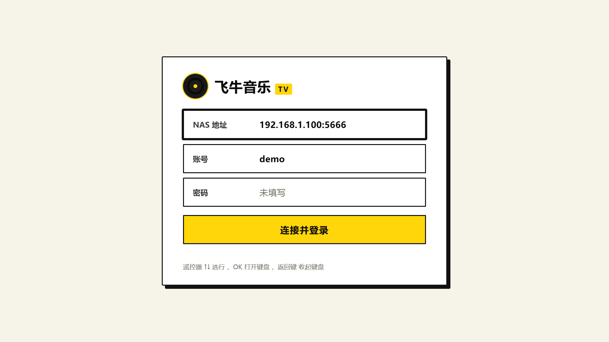
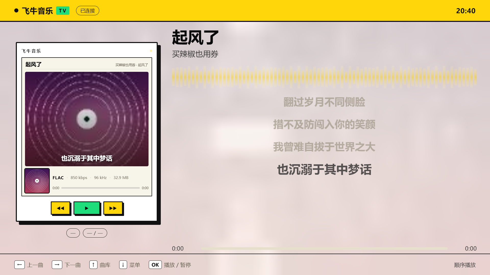
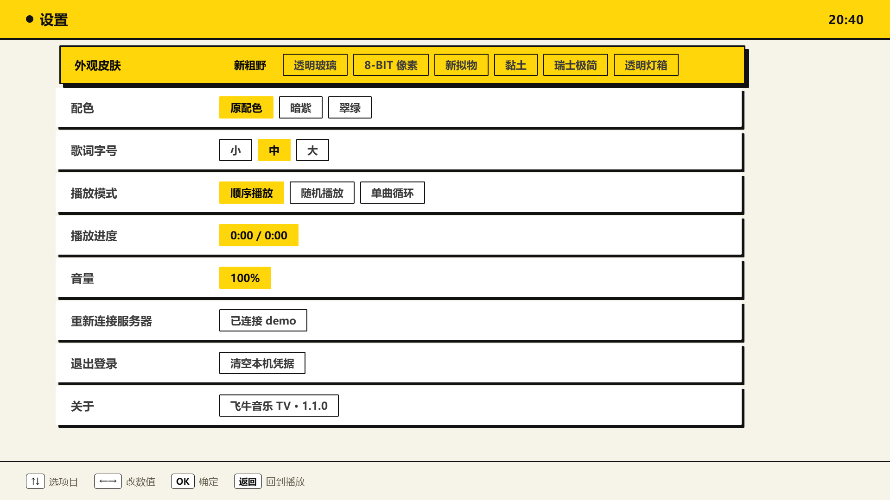

# 飞牛音乐 TV

飞牛 NAS 音乐服务的第三方 Android TV 客户端。原生 Java 实现，整套界面为遥控器重做过，不是把手机版放大的。

> ⚠️ **本项目为第三方爱好者作品，与飞牛官方无关。**
> 接口分析仅用于学习交流，请勿用于商业用途。项目不内置任何账号、地址或接口密钥，
> 使用者需自行准备。接口随时可能随官方升级而失效。

---

## 功能

**遥控器操作**
- 方向键负责导航：左右切歌，上下进功能菜单
- 长按左右 = 快退 / 快进（不是切歌）
- 全系统软键盘，纯遥控器就能输账号密码；同键连按切大小写，数字在上、标点在更上层
- 每个界面底部有按键提示条，不用背

**界面**
- 全屏播放页：封面做背景模糊、歌词叠一层、机身屏幕显示曲目参数（格式 / 码率 / 采样率 / 大小）
- 歌词 7 行固定窗口滑动，中间行高亮
- 7 套皮肤：新粗野、透明玻璃、8-BIT 像素、新拟物、黏土、瑞士极简、灯箱
- 曲库 / 专辑墙 / 歌单 / 收藏 / 搜索

**技术**
- 本地 HTTP 代理（`LocalServer.java`，只绑 127.0.0.1），网页与 Java 同源
- authx 签名和 `music-token` 会话全在 Java 侧完成，密钥不进网页
- 音频流走 Range 转发，边下边播

---

## 截图

| 登录 | 播放 |
|---|---|
|  |  |

| 曲库 | 设置 |
|---|---|
|  |  |

---

## 下载

到 **[Releases](../../releases)** 下载最新 `.apk`，U 盘拷到电视 / 盒子，
用电视上的文件管理器打开安装。

首次安装需要在系统设置里允许「安装未知来源应用」。

> 没有商业签名证书，部分国产电视的系统会提示"未知来源"/"有风险"，属正常现象。

---

## 支持设备

- Android TV / 电视盒子 / 智能电视，**Android 7.0（API 24）及以上**
- 横屏 16:9，1080p 为主（2732×1536 这类高分屏也能自适应）

实测设备：小明 Q3 Pro（Android 9）。

---

## 自行构建

依赖 **JDK 17** + **Android SDK build-tools 34**，两者都不入库，需自备。

```bash
# 1. 配置接口密钥（必须，否则连不上服务器）
cp android/assets/fn_config.example.json android/assets/fn_config.json
# 填入 authxPrefix 与 clientKey

# 2. 设置签名密码
export KS_PASS=你的签名密码

# 3. 打包
bash build_apk.sh
```

产物在项目根目录 `飞牛音乐TV-x.x.x.apk`。

### 关于签名

首次构建会在根目录生成 `fnmusic-tv.keystore`（`*.keystore` 已在 `.gitignore` 里）。

**这个文件务必单独备份。** 一旦丢失，你就再也签不出和已发布版本一致的包，
已装用户只能卸载重装。

### 关于接口密钥

`android/assets/fn_config.json` 会被打进 APK，所以它**不能进仓库**——
仓库里只有 `fn_config.example.json` 占位。

这两个值需要你自己从飞牛音乐 Web 前端的请求里分析得到。
项目作者不提供，也不对分析方法的合法性做任何承诺。

---

## 目录结构

```
android/
  AndroidManifest.xml
  java/com/junze/fntv/
    MainActivity.java     WebView + 遥控器按键拦截 + 按键音 + 诊断浮层
    LocalServer.java      本地服务：静态资源 + 飞牛接口转发 + Range 音频
    FnApi.java            authx 签名、登录、凭据存储
  assets/
    www/                  tv.html / tv.css / tv.js，全部界面
    fn_config.json        接口密钥（本机私有，不入库）
  res/                    图标与资源
build_apk.sh              aapt2 → javac → d8 → zipalign → apksigner
tools/                    开发期用的 mock 服务和截图脚本（不入库）
```

---

## License

[MIT](LICENSE)
